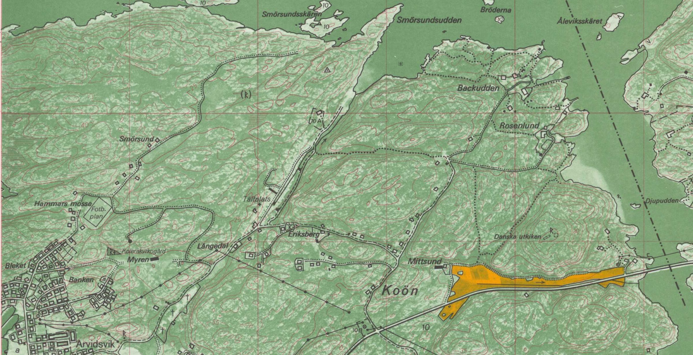
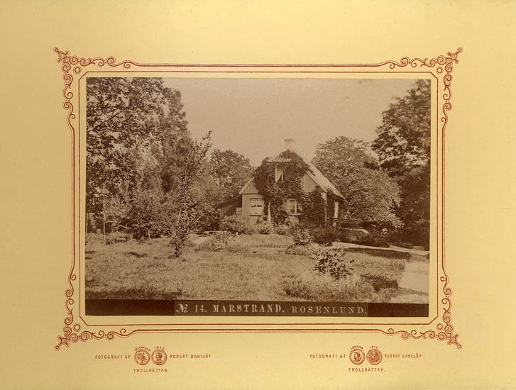
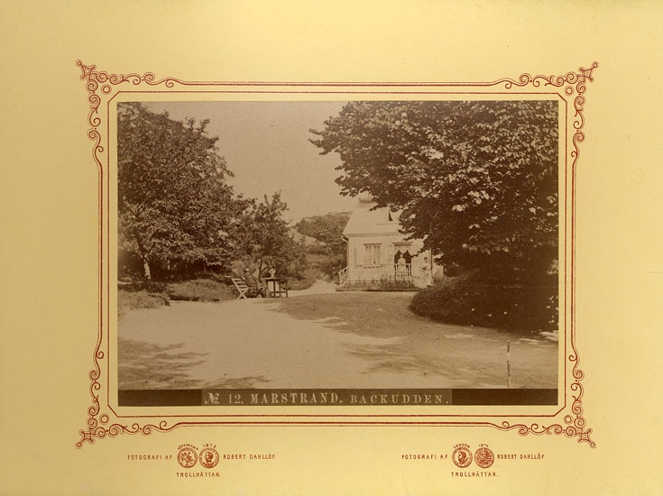
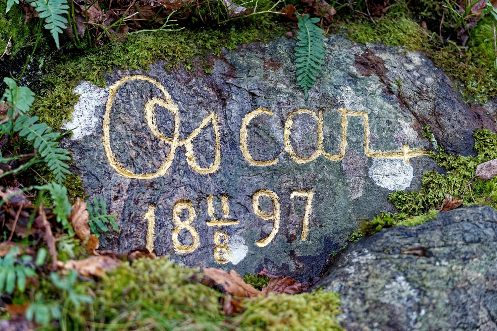
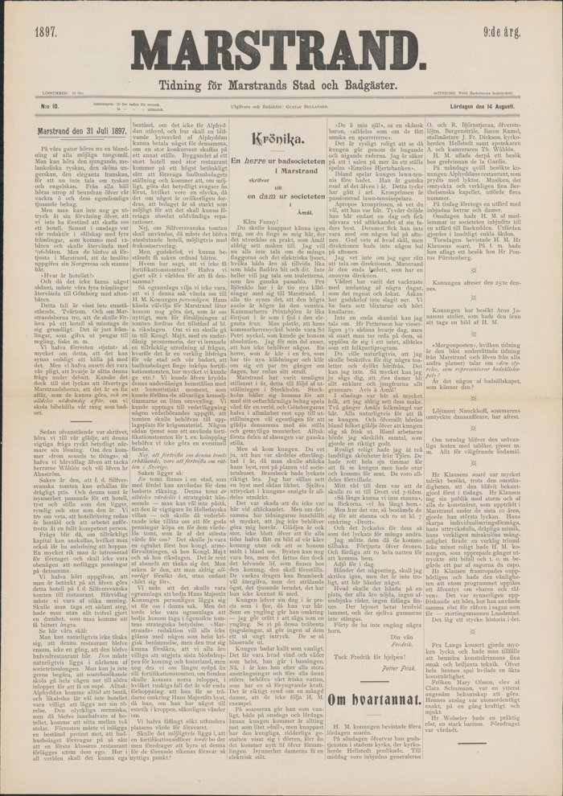

# Eriksberg och Rosenlund på Koön – källäget

Kerstin Forsberg · 7 november 2026 · [Till Sidospår](../)

Vi promenerar ofta i det här fina området på Koön, fotar och fikar, framför allt utanför säsong. När vi gick där i helgen pratade vi om när husen egentligen byggdes. Det blev början på den här sammanställningen.

## Sammanfattning

På Koön, innanför Marstrand, ligger några fina äldre hus vid Eriksberg och Rosenlund. I skogen vid Rosenlund står en sten med texten ”Oscar 18 11/8 97”. Frågan var när husen byggdes och vad som finns att berätta om dem.

- **Eriksberg.** Nuvarande mangårdsbyggnad uppfördes 1880. Platsen var sommarnöje för en Marstrandshandlare redan från 1822, samma år som badverksamheten började på Koön. Kusken på gården körde badgäster med häst och vagn till Backudden under Oscar II:s tid.
- **Rosenlund.** Det första huset byggdes i slutet av 1700-talet av Sven-Olof Rosenberg, handlare i Marstrand och direktör i Ostindiska kompaniet. Platsen hade varit salteri under det stora sillfisket. Från 1877 arrenderade Ragnar Berger stället i 43 år. Från 1920 hade diplomaten Björn Prytz det, och 1939 revs det bergerska huset och det nuvarande byggdes.
- **Backudden**, granne till Rosenlund, var sommarställe för Marstrands borgare sedan sillen tog slut 1808. De flesta husen där är sommarhus från andra halvan av 1800-talet.
- **Stenen** minner om Oscar II:s utflykt till Backudden onsdagen den 11 augusti 1897. Badgästtidningen *Marstrand* skrev tre dagar senare att kungen den onsdagen hade bjudits av medlemmar ur societeten på en utfärd till Backudden, ”i landtligt enkla åkdon”. Datumet på stenen och dagen i tidningen stämmer. Själva stenen nämns inte i tidningen.

Den bästa källan är en inventering av husen på Koön som Marstrands hembygdsförening och Marstrands fotoklubb gjorde 2005.

## Frågan och arbetsgången

Arbetet gjordes en lördagskväll, i ett samtal med Claude (Anthropic):

1. Sökning och läsning på öppna webben.
2. Läsning i webbläsaren (Claude in Chrome) av hembygdsföreningens sidor, som inte gick att hämta automatiskt.
3. Hembygdsföreningens inventering från 2005 ligger på deras webbplats som ett Windows-program (.exe) från en CD-skiva. Det laddades ned och texterna och bilderna togs ut ur filen, utan att programmet kördes.
4. Sökning via Riksarkivets MCP-server.
5. Sökning i Kungliga bibliotekets digitaliserade dagstidningar.
6. Datumet på stenen kom från ett foto som Björn Forsberg tog på en kall promenad i november 2025. Med datumet lästes badgästtidningen *Marstrand* för den veckan. Sidan maskinlästes och notisen kontrollerades mot bilden av tidningssidan.

## Husen

*Koön 1976. Backudden och Rosenlund längst upp till höger, Eriksberg i mitten, Arvidsvik och Marstrand nere till vänster. De prickade linjerna är gångstigar. Utsnitt ur Ekonomiska kartan, blad Instön 7B5a, Statens lantmäteriverk 1976.*

### Eriksberg

Eriksbergs gård var redan 1822 sommarnöje för en Marstrandshandlare, samma år som badverksamheten började på Koön. Från 1861 brukades jorden av arrendatorer, och gårdens kusk körde badgäster med häst och vagn till Backudden under Oscar II:s tid. Nuvarande mangårdsbyggnad uppfördes 1880, och ett av grannhusen byggdes som vagnsbod till gården. Från 1946 har gården varit sommarbostad.

Källorna skiljer sig i två namn. Kusken heter Johan Rasmusson i hembygdsföreningens ägarförteckning och Johan Johansson i inventeringen 2005. Handlanden från 1822 heter Erik Widell i den ena och Olof Widell i den andra.

### Rosenlund

*”No 14. Marstrand. Rosenlund.” Foto: Robert Dahllöf, 1870-talet. Bohusläns museum, UMFA55055:0013, Public Domain.*

Platsen var salteri under det stora sillfisket. I slutet av 1700-talet byggde Sven-Olof Rosenberg, handlare i Marstrand och direktör i Ostindiska kompaniet, det första huset. Under 1800-talet hade officerare och köpmän stället, och från 1877 arrenderade häradshövding Ragnar Berger det i 43 år. Det var alltså Berger som hade Rosenlund när kungen kom till Marstrand om somrarna.

1920 tog diplomaten Björn Prytz (1887–1976) över, senare svensk minister i London under andra världskriget. 1939 revs det bergerska huset och det nuvarande byggdes. Runt huvudbyggnaden ligger mindre hus för tjänstefolk, parkskötare och trädgårdsmästare, och ett båthus från omkring 1938. Parkförvaltarens hus kallades från 1887 ”Oskars hus”, efter Oskar Isaksson och hans hustru Selma. Marken har alltid varit arrendemark.

Parken blev kommunalt naturreservat 1985, omkring 40 hektar ädellövskog med ek, alm, lind och bok. Sedan 2017 ingår den i naturreservatet Marstrand.

### Backudden

*”No 12. Marstrand. Backudden.” Foto: Robert Dahllöf, 1870-talet. Bohusläns museum, UMFA55055:0009, Public Domain.*

Backudden, granne till Rosenlund, hade också salterier under sillfisket. När sillen tog slut 1808 blev udden sommarställe för Marstrands borgare. Under andra halvan av 1800-talet växte villorna fram, bland dem konsul Fredrik Holms sommarhus från 1890-talet och den så kallade Holmska villan. Ägarna var köpmän, konsuler och direktörer från Marstrand och Göteborg. Ett känt foto av hovfotografen Aron Jonason visar Oscar II på en sommarlunch på Backudden, med Lotten Abelin, Mathilde De la Gardie och fler ur kungens krets kring bordet. Fotot finns i Bernadottebiblioteket och visas, med mer om kungens somrar i Marstrand, i artikeln [Oscar II besöker Marstrand 1899](https://popularhistoria.se/kultur/fotografi/oscar-ii-besoker-marstrand-1899) i Populär Historia (2008). I Riksarkivet finns en ritning till ombyggnad av villan där från 1896.

## Stenen med Oscars namn

Stenen ligger i skogen vid Rosenlund, vid en av de många fina gamla anlagda promenadstigarna, som numera är ganska övervuxna. Inskriptionen, förgylld, lyder:

*Stenen vid Rosenlund, november 2025. Foto: Björn Forsberg.*

> Oscar
> 18 11/8 97

Det är Oscar II:s namnteckning och datumet 11 augusti 1897, skrivet på samma sätt som på hans minnessten i Östersund, ”Oscar 18 21/7 97”, från samma sommar. Kungen lät hugga in sin namnteckning på platser han besökt. Vid Oscarshöjd i Gränna finns en sten efter ett besök 1895.

Det finns sådana stenar på närmare håll också. Vid vattnet vid Nääs slott och slöjdseminarium, vid Sävelången, finns ”Kungastenen” med kungliga namnteckningar. Enligt en geocache-beskrivning höggs Oscar II:s in 1874, när han besökte August Abrahamson, och kungen kom tillbaka 1891 med sönerna Gustaf och Eugen. I Jonsered finns kungens namn med datum i berget där kraftverkskanalen börjar, från ett besök den 14 september 1901. Uppgifterna om Nääs och Jonsered är inte kontrollerade mot primärkällor.

### Vad tidningen skrev

Badgästtidningen *Marstrand* kom ut lördagen den 14 augusti 1897. På första sidan, under rubriken ”Om hvartannat”, redovisas kungens vecka dag för dag:

| Dag | Enligt tidningen |
| --- | --- |
| Lördag 7 augusti | Kungen bevistade soarén |
| Söndag 8 augusti | Gudstjänst i stadens kyrka, där kyrkoherde Hellstedt predikade. Middag med bland andra generalerna O. och R. Björnstjerna, baron Ramel och stallmästare J. Fr. Dickson. Därefter besök hos grevinnan De la Gardie |
| Måndag 9 augusti | Kväll på Alphyddans restaurang, prydd med lyktor, med Berthelsenska kapellet |
| Tisdag 10 augusti | Utfärd med inbjudna herrar och damer |
| **Onsdag 11 augusti** | ”Onsdagen hade H. M. af medlemmar ur societeten inbjudits till en utfärd till Backudden. Utfärden gjordes i landtligt enkla åkdon.” |
| Torsdag 12 augusti | Förmiddag hos Pontus Fürstenberg, kväll på herr Klausens soaré |

<figure style="flex:0 1 260px; margin:0;">

<figcaption style="font-size:0.85em;"><em>Första sidan av badgästtidningen Marstrand, 14 augusti 1897. ”Om hvartannat” börjar längst ned i den näst sista spalten och fortsätter överst i spalten längst till höger. Källa: <a href="https://tidningar.kb.se/gvxwjj4bd90tdbwp/part/1/page/1">Kungliga biblioteket, Svenska tidningar</a>. Klicka på bilden för större version.</em></figcaption>
</figure>

Tidningen meddelar också att kungen skulle resa den 25 augusti, och att han låtit fotografera sig i Aron Jonasons ateljé.

Samma nummer har ett brev från en badgäst om sommaren 1897. Sommaren hade varit stilla, eftersom många rest till utställningen i Stockholm, ”men så kom kungen”. Han var särskilt efterlängtad, eftersom hans byst av Brambeck skulle avtäckas vid societetshuset. Kronprinsen var där en dag för avtäckningen. Kungen badade kallt i bassängen i alla väder, spelade ibland lawn tennis före badet och gick på soaréerna både onsdagar och lördagar.

### Vad som inte är belagt

- Tidningen nämner inte stenen, och inte vem som högg inskriptionen eller när. Att den gjordes till minne av utflykten den 11 augusti är en slutsats av att datumet stämmer.
- Tidningen säger Backudden, inte Rosenlund. Stenen ligger i skogen vid Rosenlund, alldeles intill. Var sällskapet rastade vet vi inte.
- ”Landtligt enkla åkdon” är vagnar. Eriksbergs gård hade en kusk som enligt hembygdsföreningen körde badgäster med häst och vagn till Backudden under Oscar II:s tid. Att han körde just den här dagen vet vi inte.
- Förgyllningen är sentida underhåll. Vem som sköter stenen vet vi inte.

## Vad Riksarkivets MCP-tjänst gav

Inga träffar på stenen. Däremot några kartor, en ritning och personuppgifter:

- Karta över trankok och sillsalterier på Koön, 1789. Marstrands rådhusrätts och magistrats arkiv, Riksarkivet i Göteborg.
- Situations Charta öfver Koön vid Marstrand, 1804. Samma arkiv. Krigsarkivet har en kopia från omkring 1900.
- Ritning till ombyggnad av villan vid Backudden på Koön, 1896. D. Carnegie & Co Fastighets AB:s arkiv, Riksarkivet i Göteborg.
- Marstrands församlingsböcker 1895–1945, digitaliserade. Där bör parkförvaltaren, kusken och de som bodde året runt på Rosenlund och Eriksberg stå.
- Björn Prytz i Svenskt biografiskt lexikon.
- Claes Krantz samling, med en volym om Marstrand. Krantz skrev om Oscar II:s Marstrand.

Kartorna och ritningen har ingen bildlänk i katalogen och verkar inte vara digitaliserade. Länkarna under Källor leder därför bara till katalogposterna.

## Vad dagstidningarna gav

Marstrand hade en egen badgästtidning, *Marstrand, tidning för Marstrands stad och badgäster*. Den kom ut varje lördag under säsongen och finns digitaliserad hos Kungliga biblioteket, fri att läsa.

Den fria sökningen gav inga träffar på Rosenlund 1877–1910, och inte heller på ordet ”konungen” i augusti 1890. Sökningen träffar alltså inte på artiklarnas text. När datumet på stenen var känt lästes i stället numret från 14 augusti 1897 direkt. Första sidan maskinlästes, och notisen om utfärden till Backudden kontrollerades mot bilden av sidan. Övriga sidor i numret och numret från 21 augusti är inte lästa.

## Öppna spår

- Badgästtidningen *Marstrand* 21 augusti 1897 och övriga sidor av numret 14 augusti, om utfärden nämns igen. Även Göteborgstidningarna från de dagarna.
- Vem som högg stenen, och när. Hembygdsföreningen eller Marstrands kulturhistoriska förening kan veta.
- Marstrands församlingsböcker, för kuskens namn och för vilka som bodde på Rosenlund.
- Om Ragnar Berger, häradshövding och direktör i Alingsås, är samma person.
- Karta över sillsalterierna 1789 och situationskartan 1804, för hur Rosenlund och Backudden såg ut då.
- Ritningen till villan vid Backudden 1896.
- Inventeringen 2005 ber själv om rättelser och kompletteringar. Marstrands hembygdsförening är den naturliga kontakten.

## Källor

Hembygdsföreningen:

- [Eriksbergs gård, ägarförteckning](https://filer.hembygd.se/marstrand/files/2017/09/Eriksbergs-g%C3%A5rd-1.pdf), Marstrands hembygdsförening, 2017
- [Husen på Marstrandsön och Koön](https://www.hembygd.se/marstrand/sida-155005), Marstrands hembygdsförening. Härifrån laddades inventeringen *Husen på Koön* (2005) ned. Den gjordes av Marstrands hembygdsförening och Marstrands fotoklubb, med Stig Christoffersson som ansvarig för historiken. Den bygger bland annat på en förteckning över brandförsäkrade egendomar från 1813, en karta från 1881, Alvar Nilssons forskning i Landsarkivet i Göteborg och uppgifter från fastighetsägarna. Foton av David Isitt och Bertil Löwendahl.

Riksarkivet:

Kartorna och ritningen nedan är inte digitaliserade. Länkarna leder till Riksarkivets katalogpost, inte till själva kartan:

- [Karta över trankok och sillsalterier på Koön](https://sok.riksarkivet.se/arkiv/3xruKpzFrADPjTY8GY2DyA), 1789 (katalogpost)
- [Situations Charta öfver Koön vid Marstrand](https://sok.riksarkivet.se/arkiv/hzxLhzcu8fCbkB91TPHqL7), 1804 (katalogpost)
- [Situationskarta över Koön vid Marstrand](https://sok.riksarkivet.se/arkiv/8nfD1t08VaECX0Ro4EGSO0), kopia omkring 1900, Krigsarkivet (katalogpost)
- [Ritning till ombyggnad av villan vid Backudden på Koön](https://sok.riksarkivet.se/arkiv/hzERhzWyHSbrLVpwj5YMKN), 1896 (katalogpost)

Övrigt från Riksarkivet:

- [Marstrands församlingsbok 1895–1912](https://sok.riksarkivet.se/bildvisning/00120123), [1912–1932](https://sok.riksarkivet.se/bildvisning/00098196), [1932–1945](https://sok.riksarkivet.se/bildvisning/00098199) (digitaliserade, länkarna öppnar själva böckerna)
- [Björn G Prytz](https://sok.riksarkivet.se/sbl/Presentation.aspx?id=7409), Svenskt biografiskt lexikon
- [Claes Krantz samling, Marstrand](https://sok.riksarkivet.se/arkiv/dgQmz4zTyg8qta00I810yx) (katalogpost, inte digitaliserad)

Oscar II och Marstrand:

- [Kung Oscar II anländer till Marstrand](https://digitaltmuseum.se/011014327065/kung-oscar-ii-anlander-till-marstrand), Bohusläns museum via DigitaltMuseum
- [Oscar II besöker Marstrand 1899](https://popularhistoria.se/kultur/fotografi/oscar-ii-besoker-marstrand-1899), Jacob Wiberg, Populär Historia 7/2008. Om Aron Jonasons foto från lunchen på Backudden
- [Badorten Marstrand](https://www.bohuslansmuseum.se/samlingar-och-historia/gamla-historiska-artiklar/badorten-marstrand/), Bohusläns museum

Stenar med Oscar II:s namn på andra platser:

- [Grännabergsleden](http://jennysutflykter.blogspot.com/2014/06/grannabergsleden.html), bloggen Jennys utflykter, om stenen vid Oscarshöjd i Gränna
- [Slottsparken](https://naas.se/se-gora/slottsparken/), Nääs slott, om Kungastenen med kungliga autografer
- [Folk och figurer från Nääs; Grottan o Kungastenen](https://www.geocaching.com/geocache/GC33TWZ), geocache GC33TWZ
- [Oscar II firas årligen i Jonsered](https://larsgahrnskriver.wordpress.com/2013/05/23/oscar-ii-firas-arligen-i-jonsered/), bloggen Lars Gahrn skriver, 2013
- [Oscar II besök, minnessten, Östersund](https://commons.wikimedia.org/wiki/File:Oscar_II_bes%C3%B6k,_minnessten,_%C3%96stersund,_juni_2023.jpg), Wikimedia Commons

Karta:

- [Ekonomiska kartan, blad Instön 7B5a](https://historiskakartor.lantmateriet.se/hk/viewer/internal/J133-7B5a76/52414b5f4a3133332d374235613736/rak2/RAK/Inst%C3%B6n,%207B5a76/Ekonomiska%20kartan), Statens lantmäteriverk 1976, via Lantmäteriets Historiska kartor (länken öppnar själva kartan). Ekonomiska kartan är öppna data under CC0 enligt Lantmäteriets produktbeskrivning.

Bilder från Bohusläns museum via DigitaltMuseum, alla märkta Public Domain (länkarna öppnar bildsidan):

- [Rosenlund, Marstrand](https://digitaltmuseum.se/011014497911/rosenlund-marstrand), Robert Dahllöf, 1870-talet
- [Backudden, Marstrand](https://digitaltmuseum.se/011014497907/backudden-marstrand), Robert Dahllöf, 1870-talet

Övrigt:

- [Rosenlunds naturreservat](https://sv.wikipedia.org/wiki/Rosenlunds_naturreservat), svenska Wikipedia
- [Jakten på Koökrokodilen](https://hallensgeocachingaventyr.com/2022/03/05/jakten-pa-kookrokodilen/), geocachingblogg
- [Marstrand, tidning för Marstrands stad och badgäster, lördagen den 14 augusti 1897, sidan 1](https://tidningar.kb.se/gvxwjj4bd90tdbwp/part/1/page/1). Tryckt i Göteborg hos Wald. Zachrissons boktryckeri. Digitaliserad av Kungliga biblioteket, Svenska tidningar. Tidningssidan på den här sidan är hämtad i full upplösning från KB:s bildtjänst, fil `bibq1jxnlc3nfrb211g_18970814_166129_10_0001.jp2`, och förminskad.
